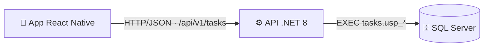

# Task Manager · Reto técnico React Native + .NET

Mini app móvil de gestión de tareas personales: **listar**, **filtrar por estado y prioridad** y **ver el detalle** de una tarea.

| Capa | Tecnología |
|---|---|
| App móvil | React Native 0.87 (**CLI**, sin Expo) · TypeScript · React Navigation (native stack) · **sin UI Kit** |
| Backend | Microservicio REST **.NET 8** · ASP.NET Core · arquitectura hexagonal · ADO.NET |
| Base de datos | **SQL Server 2022** · procedimientos almacenados · datos de ejemplo |
| Calidad | xUnit (53 pruebas) · Jest + Testing Library (33 pruebas) · analizadores .NET, ESLint, Prettier, TypeScript estricto |

📄 **Documentación técnica** (diagramas de arquitectura y de comunicación, justificación de decisiones, seguridad, escalabilidad y casos borde): [`docs/ARCHITECTURE.md`](docs/ARCHITECTURE.md)



---

## Estructura del repositorio

```
.
├── backend/                         # Microservicio .NET 8
│   ├── src/
│   │   ├── TaskManager.Domain/          # Entidad TaskItem + invariantes (sin dependencias)
│   │   ├── TaskManager.Application/     # Casos de uso (queries), validación, DTOs, puerto ITaskRepository
│   │   ├── TaskManager.Infrastructure/  # Adaptador SQL Server (ADO.NET + procedimientos almacenados)
│   │   └── TaskManager.Api/             # Controller REST, middleware, health checks, Swagger
│   ├── tests/
│   │   ├── TaskManager.UnitTests/
│   │   └── TaskManager.Api.IntegrationTests/
│   └── Dockerfile
├── database/scripts/                # 01 BD · 02 esquema · 03 SPs · 04 datos · 00 ejecuta todo
├── mobile/                          # App React Native (CLI)
│   ├── src/
│   │   ├── app/                     # Navegación tipada + composition root
│   │   ├── core/http/               # Cliente HTTP (timeout, cancelación, errores tipados)
│   │   ├── shared/ui/               # Design system propio (tokens, modo oscuro, componentes base)
│   │   └── features/tasks/          # domain · data · application (hooks) · presentation (pantallas)
│   └── test/support/                # Fakes y helpers de pruebas
├── docs/ARCHITECTURE.md             # Documentación técnica
└── docker-compose.yml               # SQL Server + inicialización + API
```

---

## Requisitos

| Para | Necesitas |
|---|---|
| Backend con Docker (recomendado) | Docker Desktop |
| Backend sin Docker | .NET SDK 8 · SQL Server 2019+ (Express/Developer/LocalDB) · `sqlcmd` o SSMS |
| App móvil | Node.js ≥ 22.11 · JDK 17 · Android Studio + emulador (o Xcode + CocoaPods en macOS) — ver [entorno de React Native CLI](https://reactnative.dev/docs/set-up-your-environment) |

---

## 1. Levantar el backend

### Opción A — Docker (un solo comando)

```bash
docker compose up --build
```

Esto levanta SQL Server, ejecuta los scripts de `database/scripts` (esquema, procedimientos y datos) y arranca la API.

- API: <http://localhost:5080/api/v1/tasks>
- Swagger: <http://localhost:5080/swagger>
- Salud: <http://localhost:5080/health/ready>

> La contraseña de SQL Server por defecto es `TaskManager!Dev2026`. Para cambiarla copia `.env.example` a `.env`.
> Para empezar de cero (borrar datos): `docker compose down -v`.

### Opción B — Manual

**1) Base de datos.** Ejecuta los scripts **en orden** sobre tu instancia de SQL Server:

```bash
cd database/scripts
sqlcmd -S localhost -U sa -P "<tu-password>" -C -i 00_run_all.sql
```

(En SSMS: abre `00_run_all.sql`, activa *Query → SQLCMD Mode* y ejecuta. O ejecuta `01` → `02` → `03` → `04` uno por uno.)
Los scripts son idempotentes: se pueden ejecutar varias veces.

**2) Cadena de conexión.** Por defecto, en Development se usa la de `backend/src/TaskManager.Api/appsettings.Development.json`:

```
Server=localhost,1433;Database=TaskManagerDb;User Id=sa;Password=TaskManager!Dev2026;TrustServerCertificate=True;Encrypt=True
```

Para usar la tuya **sin modificar archivos versionados**, usa User Secrets o una variable de entorno:

```bash
cd backend/src/TaskManager.Api
dotnet user-secrets set "Database:ConnectionString" "Server=localhost;Database=TaskManagerDb;Trusted_Connection=True;TrustServerCertificate=True"
# o:  export Database__ConnectionString="..."   (PowerShell: $env:Database__ConnectionString="...")
```

**3) Ejecutar la API.**

```bash
cd backend
dotnet run --project src/TaskManager.Api      # http://localhost:5080  (Swagger en /swagger)
```

> Si la cadena de conexión falta, la API **no arranca** y lo indica (validación al inicio).

### Endpoints

| Método | Ruta | Descripción |
|---|---|---|
| GET | `/api/v1/tasks?status=&priority=&page=1&pageSize=20` | Lista paginada. `status`: `Pending` · `InProgress` · `Completed`. `priority`: `Low` · `Medium` · `High`. Ambos opcionales y combinables. |
| GET | `/api/v1/tasks/{id}` | Detalle de una tarea (incluye descripción). |
| GET | `/health/live` · `/health/ready` | Liveness / readiness (con BD). |

Ejemplos listos para usar en [`backend/src/TaskManager.Api/TaskManager.Api.http`](backend/src/TaskManager.Api/TaskManager.Api.http) (VS Code REST Client / Visual Studio / Rider).

---

## 2. Ejecutar la app móvil

```bash
cd mobile
npm install
npm start               # Metro bundler (déjalo corriendo)
npm run android         # en otra terminal (emulador Android abierto)
# macOS / iOS:  cd ios && bundle install && bundle exec pod install && cd .. && npm run ios
```

**URL de la API.** Está en [`mobile/src/config/env.ts`](mobile/src/config/env.ts):

| Dónde corre la app | URL que usa | ¿Hay que cambiar algo? |
|---|---|---|
| Emulador Android | `http://10.0.2.2:5080` (alias del PC host) | No |
| Simulador iOS | `http://localhost:5080` | No |
| Teléfono físico | IP de tu PC en la red, p. ej. `http://192.168.1.20:5080` | Sí: edita `DEFAULT_HOST` en `env.ts`. La API ya escucha en `0.0.0.0:5080`; permite el puerto en el firewall. Alternativa en Android por USB: `adb reverse tcp:5080 tcp:5080` y usa `http://localhost:5080`. |

---

## 3. Pruebas y calidad

```bash
# Backend: unitarias + integración (la integración levanta la API en memoria, no necesita SQL Server)
cd backend
dotnet test

# App
cd mobile
npm test                # Jest
npm run test:coverage   # con cobertura
npm run typecheck       # TypeScript
npm run lint            # ESLint
```

El backend compila con `TreatWarningsAsErrors` y analizadores de .NET activos.

---

## 4. Decisiones principales (resumen)

El detalle y las alternativas descartadas están en [`docs/ARCHITECTURE.md` § 6](docs/ARCHITECTURE.md#6-decisiones-técnicas-clave).

- **Hexagonal en 4 proyectos**: las fronteras entre capas las impone el compilador; el dominio no conoce HTTP ni SQL. Las pruebas de integración cambian solo el adaptador de BD.
- **ADO.NET + procedimientos almacenados**: con SPs, un ORM no aporta generación de SQL; el mapeo es pequeño y explícito.
- **SP con filtros opcionales + `OPTION (RECOMPILE)`** y **orden estable** (`prioridad, fecha, id`) para que la paginación sea determinista.
- **Errores RFC 7807** centralizados con `traceId`; **validación** en la capa de aplicación; **invariantes** en el dominio (los datos corruptos de BD fallan en el borde).
- **App por features con capas** (domain / data / application / presentation), **puerto `TaskRepository`** inyectado por Context, **sin librería de estado global** (filtros como parámetros de navegación) y **design system propio** con modo oscuro y accesibilidad.
- **Cancelación de punta a punta**: si el usuario cambia de filtro, se aborta el `fetch`, la petición HTTP y la consulta SQL; las respuestas obsoletas se descartan.

## 5. Historial de commits

El repositorio usa [Conventional Commits](https://www.conventionalcommits.org/es/) (`feat`, `fix`, `test`, `docs`, `chore`, `build`) con un commit por unidad lógica de cambio: `git log --oneline`.

## 6. Fuera de alcance (según el enunciado)

Autenticación, CRUD completo, despliegue / CI-CD y multiusuario. La documentación técnica explica cómo se incorporarían sin cambiar la arquitectura.
