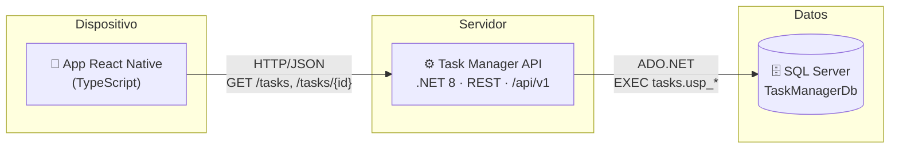
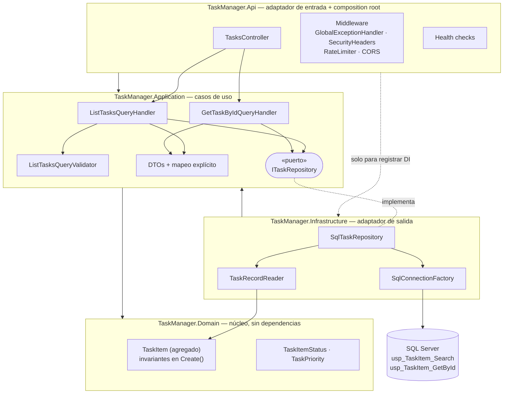
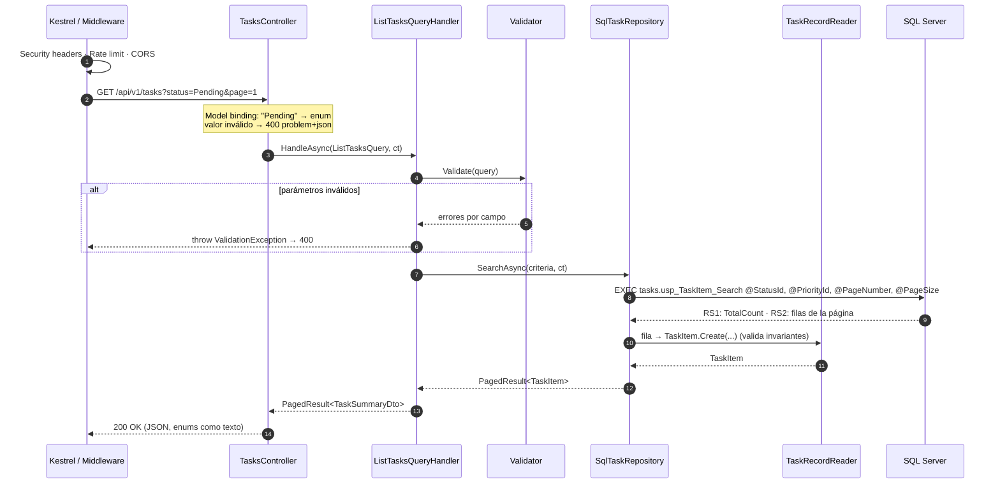
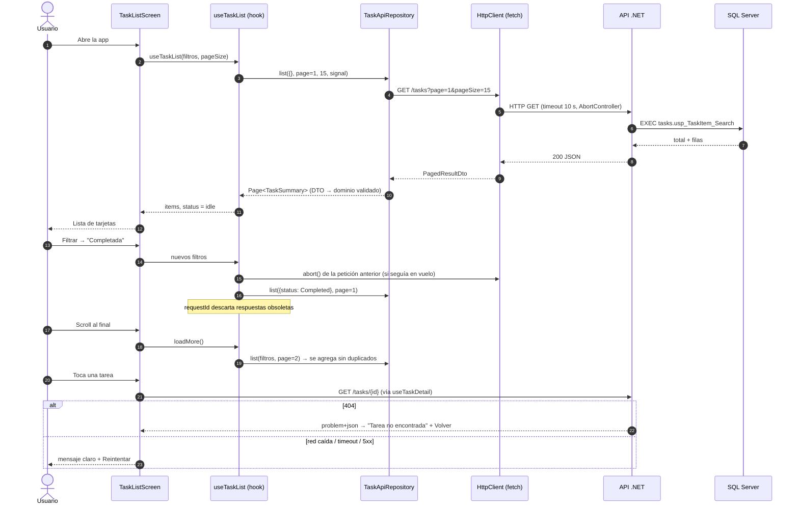
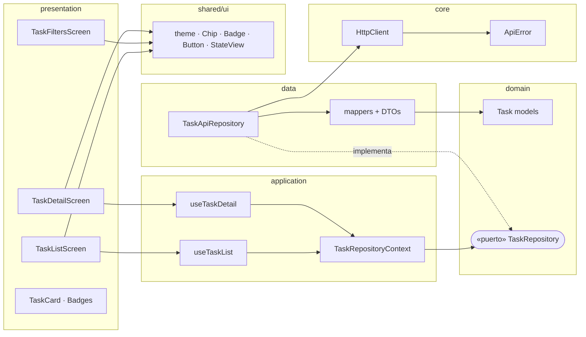
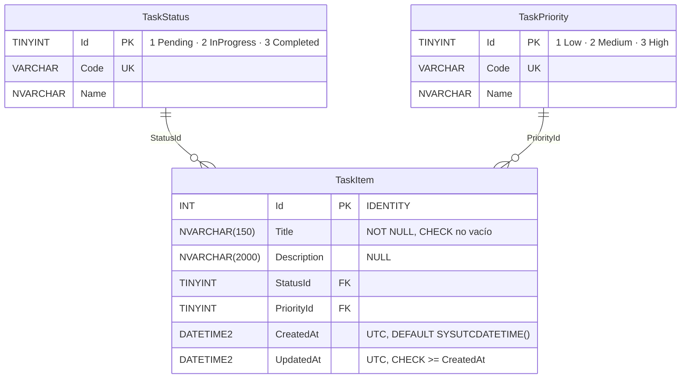

# Documentación técnica

Mini app de gestión de tareas: **React Native (CLI)** → **microservicio REST .NET 8** → **SQL Server** con procedimientos almacenados.

> Este documento prioriza el **porqué** de cada decisión. El **qué** está en el código y el **cómo ejecutarlo** en el [README](../README.md).
>
> Los diagramas están en Mermaid (se ven en GitHub/GitLab y VS Code). También hay versión en imagen en [`docs/diagrams/`](diagrams/).

Contenido:

1. [Vista general](#1-vista-general)
2. [Arquitectura del backend](#2-arquitectura-del-backend)
3. [Comunicación App ↔ API ↔ DB](#3-comunicación-app--api--db)
4. [Arquitectura del frontend](#4-arquitectura-del-frontend)
5. [Base de datos](#5-base-de-datos)
6. [Decisiones técnicas clave](#6-decisiones-técnicas-clave)
7. [Casos borde contemplados](#7-casos-borde-contemplados)
8. [Seguridad](#8-seguridad)
9. [Escalabilidad](#9-escalabilidad)
10. [Pruebas](#10-pruebas)
11. [Qué haría a continuación](#11-qué-haría-a-continuación)

---

## 1. Vista general



| Pieza | Responsabilidad | Tecnología |
|---|---|---|
| App móvil | Listar, filtrar y ver detalle; manejar estados de carga/error/vacío | React Native 0.87 (CLI), TypeScript, React Navigation |
| API | Validar entrada, aplicar casos de uso, exponer contrato REST estable | ASP.NET Core 8, arquitectura hexagonal |
| Base de datos | Persistencia, integridad, consultas optimizadas | SQL Server 2022, procedimientos almacenados |

---

## 2. Arquitectura del backend

Arquitectura **hexagonal (puertos y adaptadores)** organizada en 4 proyectos. La **regla de dependencias** apunta siempre hacia el dominio: el núcleo no conoce HTTP ni SQL.



### Capas y responsabilidades

| Proyecto | Contiene | Depende de | Por qué existe |
|---|---|---|---|
| **Domain** | `TaskItem`, enums, `DomainException` | nada | Las reglas del negocio (título obligatorio, longitudes, fechas coherentes) viven en un solo lugar y no cambian si cambia la BD o el framework. |
| **Application** | Queries + handlers, validación, DTOs, **puerto** `ITaskRepository` | Domain | Orquesta los casos de uso. Define *qué* datos necesita (puerto) sin saber *cómo* se obtienen. |
| **Infrastructure** | `SqlTaskRepository`, fábrica de conexiones, opciones | Application | Adaptador concreto. Es el único proyecto que referencia `Microsoft.Data.SqlClient`. |
| **Api** | Controller, middleware, health checks, Swagger, `Program.cs` | Application (+ Infrastructure solo para DI) | Traduce HTTP ↔ casos de uso. Es el *composition root*. |

### Flujo de una petición dentro del backend



### Contrato REST

| Método | Ruta | Parámetros | Respuestas |
|---|---|---|---|
| `GET` | `/api/v1/tasks` | `status` (Pending · InProgress · Completed), `priority` (Low · Medium · High), `page` (≥1), `pageSize` (1–100) | `200` página · `400` problem+json |
| `GET` | `/api/v1/tasks/{id}` | `id` entero positivo | `200` detalle · `400` · `404` problem+json |
| `GET` | `/health/live` | — | `200` si el proceso vive |
| `GET` | `/health/ready` | — | `200` si además llega a la BD, si no `503` |

Ejemplo de respuesta del listado:

```json
{
  "items": [
    { "id": 3, "title": "Revisar PR de autenticación", "priority": "High", "status": "InProgress",
      "createdAt": "2026-10-09T05:00:00Z", "updatedAt": "2026-10-09T14:00:00Z" }
  ],
  "pageNumber": 1, "pageSize": 15, "totalCount": 30, "totalPages": 2, "hasNextPage": true
}
```

Todos los errores siguen **RFC 7807** (`application/problem+json`) e incluyen `traceId` para correlacionar con los logs:

```json
{ "title": "La solicitud tiene parámetros inválidos.", "status": 400,
  "errors": { "PageSize": ["El tamaño de página debe estar entre 1 y 100."] }, "traceId": "0HN..." }
```

---

## 3. Comunicación App ↔ API ↔ DB



**Por qué así:**

- **El listado no trae la descripción** (hasta 2000 caracteres): se pide solo en el detalle. Menos bytes por página en redes móviles.
- **Paginación del lado servidor** (`OFFSET/FETCH`) y scroll infinito: la app nunca descarga toda la tabla.
- **Filtros en el servidor** (no en el cliente): con paginación, filtrar localmente daría resultados incompletos.
- **Cancelación de punta a punta**: si el usuario cambia de filtro, la app aborta el `fetch`, ASP.NET cancela el `CancellationToken` y ADO.NET cancela la consulta en SQL Server. No se gasta BD en respuestas que nadie verá.

---

## 4. Arquitectura del frontend

Organización **por feature** con capas internas (mismo espíritu hexagonal que el backend, adaptado a React):

```
mobile/src
├── app/                      # Composition root: App, navegación tipada, providers (DI)
├── config/env.ts             # URL de la API por plataforma, timeout, tamaño de página
├── core/http/                # HttpClient (fetch + timeout + cancelación) y ApiError normalizado
├── shared/
│   ├── ui/                   # Design system propio: theme (tokens + modo oscuro), Chip, Badge, Button, StateView
│   └── utils/                # formatDate
└── features/tasks/
    ├── domain/               # Modelo (TaskSummary, TaskDetail, TaskFilters) + puerto TaskRepository
    ├── data/                 # DTOs, mappers (validan el contrato) y TaskApiRepository (adaptador)
    ├── application/          # Hooks de casos de uso: useTaskList, useTaskDetail + contexto de DI
    └── presentation/         # Pantallas (Lista, Filtros, Detalle) y componentes (TaskCard, badges)
```



**Pantallas:**

| Pantalla | Qué hace |
|---|---|
| **Lista** (`TaskListScreen`) | Tarjetas con título (máx. 2 líneas), estado, prioridad (badge + franja de color) y antigüedad. Pull-to-refresh, scroll infinito, contador de resultados, chips de filtros activos removibles. Estados: cargando, error con reintento, vacío (distingue "sin tareas" de "sin resultados para estos filtros" con botón *Limpiar filtros*). |
| **Filtros** (`TaskFiltersScreen`, modal) | Selección única por grupo (Estado / Prioridad) con opción *Todos*. Trabaja sobre un **borrador** y aplica al confirmar; *Limpiar* quita todo. |
| **Detalle** (`TaskDetailScreen`) | Título, badges, descripción completa (o aviso si no tiene), fechas de creación/actualización en hora local. 404 → "Tarea no encontrada" + *Volver*; otros errores → *Reintentar*. |

**Decisiones del frontend:**

- **Sin UI Kit, con design tokens propios** (`shared/ui/theme.ts`): colores, espaciado, radios y tipografía centralizados; soporte de **modo oscuro** automático. Los componentes base (Chip, Badge, Button, StateView) son pequeños y accesibles (`accessibilityRole`, `accessibilityState`, etiquetas descriptivas, áreas táctiles ≥ 44 pt, el significado no depende solo del color).
- **Sin Redux / Zustand / React Query**: el estado es local a cada pantalla y los filtros viajan como **parámetros de navegación** (estado navegable, compatible con deep links). Agregar una librería global para 3 pantallas sería complejidad sin beneficio. Si la app creciera (caché compartida, invalidación, offline) el siguiente paso natural sería **TanStack Query** detrás del mismo puerto `TaskRepository`.
- **Sin axios**: `fetch` + `AbortController` cubren GET/JSON, timeout y cancelación en ~80 líneas testeadas.
- **Puerto `TaskRepository` + inyección por Context**: los hooks no conocen HTTP. En pruebas se inyecta un fake en memoria; mañana podría existir un repositorio con caché offline sin tocar pantallas.
- **Mappers que validan el contrato**: si la API envía un estado que la app no conoce, falla en el borde con un error claro en lugar de un crash dentro de un componente.
- **Navegación nativa** (`@react-navigation/native-stack`): usa los stacks nativos de iOS/Android (mejor rendimiento y gestos que un stack en JS). React Navigation no es un UI Kit, solo enrutamiento.

---

## 5. Base de datos



| Script | Contenido |
|---|---|
| `01_create_database.sql` | Crea `TaskManagerDb` y activa `READ_COMMITTED_SNAPSHOT`. |
| `02_schema.sql` | Schema `tasks`, catálogos, tabla, FKs, CHECKs e índices. |
| `03_stored_procedures.sql` | `usp_TaskItem_Search`, `usp_TaskItem_GetById` y rol `task_api_executor` (solo EXECUTE). |
| `04_seed_data.sql` | Catálogos (MERGE) y 30 tareas de ejemplo con casos borde. |
| `00_run_all.sql` | Ejecuta los cuatro en orden (modo SQLCMD). |

Todos son **idempotentes** (`IF NOT EXISTS`, `CREATE OR ALTER`, `MERGE`): se pueden re-ejecutar sin errores ni duplicados.

---

## 6. Decisiones técnicas clave

| # | Decisión | Alternativas consideradas | Por qué |
|---|---|---|---|
| 1 | **Arquitectura hexagonal en 4 proyectos** | Un solo proyecto con carpetas; Clean Architecture completa con MediatR | Las fronteras entre proyectos las **impone el compilador** (Domain no puede referenciar SqlClient por accidente). Es la misma estructura que escalaría a un proyecto grande, sin ceremonias extra para dos endpoints. |
| 2 | **CQRS ligero sin MediatR** (`IQueryHandler<TQuery,TResult>`) | MediatR | El reto solo tiene lecturas. Una interfaz propia de 1 método da la misma separación, sin dependencia (MediatR pasó a licencia comercial en 2025) y sin "magia" de reflexión. Permite decoradores (logging, caché) si hicieran falta. |
| 3 | **ADO.NET directo para invocar SPs** | Entity Framework Core; Dapper | Con procedimientos almacenados el ORM no genera SQL, que es su principal valor. EF Core aportaría tracking y migraciones que no se usan. El mapeo son 7 columnas (`TaskRecordReader`). Dapper sería razonable; se evitó para no sumar dependencias por tan poco código. |
| 4 | **Procedimientos almacenados** (requisito) con patrón *catch-all* + `OPTION (RECOMPILE)` | SQL dinámico con `sp_executesql`; un SP por combinación de filtros | `(@p IS NULL OR col = @p)` es legible y con `RECOMPILE` el optimizador usa el plan correcto para cada combinación de filtros (evita *parameter sniffing*). El costo de compilar es despreciable a este volumen; con millones de filas y alta concurrencia se migraría a SQL dinámico parametrizado. |
| 5 | **Catálogos `TaskStatus` / `TaskPriority` como tablas con FK** | Columnas `VARCHAR` con texto libre o `CHECK` | Integridad referencial, índices compactos (`TINYINT`), orden natural por prioridad, y nombres traducibles en BD. Los Ids coinciden con los enums de .NET (contrato explícito y documentado en ambos lados). |
| 6 | **Paginación obligatoria con límite (máx. 100)** | Devolver todo | Protege a la API y a la BD de respuestas sin límite y a la app de listas enormes. El SP también se defiende (normaliza valores fuera de rango). |
| 7 | **Orden estable `PriorityId DESC, CreatedAt DESC, Id DESC`** | Solo por prioridad | Lo urgente y reciente primero. El `Id` como desempate hace la paginación **determinista** (sin él, filas con igual prioridad/fecha pueden repetirse o saltarse entre páginas). |
| 8 | **Validación en Application, invariantes en Domain** | Data annotations en el controller | La validación es del caso de uso, no de HTTP: cualquier adaptador de entrada (REST, gRPC, cola) obtiene las mismas reglas. El dominio además rechaza datos corruptos que vengan de la BD (*fail fast*). |
| 9 | **Errores RFC 7807 centralizados** (`GlobalExceptionHandler`) | try/catch en cada acción | Un solo formato para la app, controllers sin ruido, nunca se filtra un stack trace, y `traceId` para soporte. |
| 10 | **Enums como texto en JSON** (`"High"`) | Números (`3`) | Contrato legible y estable aunque cambie el orden interno del enum. |
| 11 | **DTO de lista sin descripción** | Mismo DTO para lista y detalle | Menos payload por página; la descripción completa se carga bajo demanda en el detalle. |
| 12 | **Opciones tipadas con `ValidateOnStart`** | Leer `IConfiguration` donde se necesite | Si falta la cadena de conexión la API **no arranca** (fail fast) en vez de fallar en la primera petición. |
| 13 | **Versionado en la ruta** (`/api/v1`) | Sin versión | Una app móvil no se actualiza al instante en todos los dispositivos: cambios incompatibles irían a `/v2` sin romper versiones instaladas. |
| 14 | **Fechas en UTC** (`DATETIME2` + `SYSUTCDATETIME`) | Hora local del servidor | El servidor no conoce la zona del usuario; la app convierte a la hora del dispositivo. |
| 15 | **Central Package Management + `TreatWarningsAsErrors` + analizadores** | Versiones por proyecto, warnings ignorados | Una sola fuente de versiones; los analizadores (CA*) y el estilo (`.editorconfig`) se aplican en compilación, no por disciplina. |

---

## 7. Casos borde contemplados

| Caso | Dónde se maneja | Resultado |
|---|---|---|
| `?status=Unknown`, `?status=99`, `?priority=Urgent` | Model binding + validador | `400` problem+json con el campo inválido |
| `page=0`, `pageSize=0`, `pageSize=500` | Validador (y el SP se defiende igual) | `400` con mensaje por campo |
| Página más allá del total | Handler | `200` con `items: []` (no es error) |
| Filtros sin resultados | Handler / app | Lista vacía; la app ofrece *Limpiar filtros* |
| `GET /tasks/0`, `/tasks/-1` | Handler | `400` |
| `GET /tasks/abc` | Restricción de ruta `{id:int}` | `404` |
| Tarea inexistente | Handler → `NotFoundException` | `404` problem+json; app: "Tarea no encontrada" + Volver |
| Dato corrupto en BD (estado 9, título vacío) | `TaskRecordReader` → `TaskItem.Create` | Falla en el borde con `DomainException` (log + 500 genérico), no viaja basura a la app |
| Cliente cancela la petición | `CancellationToken` hasta SQL Server; handler responde 499 sin loguear como error | No se consume BD en vano |
| BD caída | `/health/ready` → 503; endpoints → 500 genérico con traceId | La app muestra "El servidor tuvo un problema" + Reintentar |
| Sin red / servidor apagado / timeout (10 s) | `HttpClient` → `ApiError` tipado | Mensaje específico + Reintentar |
| Respuesta tardía de un filtro anterior | `useTaskList` (requestId + abort) | Se descarta; nunca pisa el resultado actual |
| `onEndReached` disparado varias veces | `useTaskList` (bandera de carga en curso) | Una sola petición por página |
| Datos que cambian entre páginas | `useTaskList` deduplica por Id | Sin tarjetas repetidas |
| Falla al cargar la página 2+ | `useTaskList` (`loadMoreError`) | Se conservan las tareas ya cargadas; pie con *Toca para reintentar* |
| Título muy largo / descripción extensa / emoji / tildes | `NVARCHAR`, UI con `numberOfLines`, `ScrollView` | Lista: 2 líneas; detalle: completo con scroll |
| Descripción `NULL` o solo espacios | Dominio y mapper normalizan a `null` | Detalle: "Esta tarea no tiene descripción." |
| Estado/prioridad desconocido en la respuesta | Mapper del front | Error claro de contrato en vez de crash |
| Pantalla desmontada con petición en vuelo | Hooks abortan en el cleanup | Sin actualizaciones de estado sobre componentes desmontados |

---

## 8. Seguridad

Aunque autenticación queda fuera del alcance, la API se diseñó para no tener que "rehacer" nada cuando se agregue:

- **SQL injection**: imposible por construcción — solo procedimientos almacenados con **parámetros tipados** (`DbType`), nunca concatenación.
- **Mínimo privilegio en BD**: rol `task_api_executor` con `GRANT EXECUTE ON SCHEMA::tasks` y **sin** `SELECT` directo sobre tablas. En producción la API usaría un login propio en ese rol, no `sa`.
- **Secretos fuera del repositorio base**: `appsettings.json` no contiene credenciales; se inyectan por variable de entorno (`Database__ConnectionString`), User Secrets o un vault. La contraseña de desarrollo solo está en `appsettings.Development.json` / `.env`.
- **Rate limiting** por IP (120 req/min configurable) → `429`.
- **Cabeceras de seguridad** en todas las respuestas, incluidas las de error: `X-Content-Type-Options`, `X-Frame-Options`, `Referrer-Policy`, `Content-Security-Policy`.
- **HTTPS + HSTS** fuera de Development. **CORS** cerrado por defecto (solo GET y orígenes configurados; la app nativa no lo necesita).
- **Sin fuga de información**: errores 500 genéricos con `traceId`; el detalle queda solo en logs.
- **Contenedor**: imagen runtime sin SDK, ejecutando como usuario no root.
- **App**: `cleartext` (HTTP) solo en debug por la plantilla de RN; en release se usaría HTTPS. `allowBackup=false` en Android.
- **Al agregar autenticación**: JWT/OIDC en el middleware, `UserId` como columna + filtro en los SPs (las "tareas personales" ya pasan por un único punto: `TaskSearchCriteria`).

---

## 9. Escalabilidad

- **API stateless**: escala horizontalmente detrás de un balanceador; health checks `live`/`ready` listos para Kubernetes / App Service.
- **Índices cubrientes** alineados con los patrones reales (`StatusId, PriorityId DESC, CreatedAt DESC` `INCLUDE (Title, UpdatedAt)` y otro por prioridad): el listado no hace *key lookups*.
- **Payload mínimo**: DTO de lista sin descripción + paginación con tope.
- **Connection pooling** de ADO.NET (la fábrica crea conexiones lógicas; el pool reutiliza las físicas) y `CommandTimeout` configurable.
- **`READ_COMMITTED_SNAPSHOT`**: las lecturas no se bloquean con escrituras cuando exista el CRUD.
- **Async + cancelación de punta a punta**: los hilos no se bloquean esperando I/O.
- **Siguientes pasos si creciera el volumen**: paginación por *keyset* (cursor) en vez de `OFFSET` para páginas profundas; caché de lectura (Redis / `OutputCache`) con invalidación al escribir; réplicas de lectura; SQL dinámico parametrizado en lugar de `RECOMPILE` si la tasa de consultas lo justificara; observabilidad con OpenTelemetry.

---

## 10. Pruebas

| Suite | Qué cubre | Cantidad |
|---|---|---|
| `TaskManager.UnitTests` (xUnit) | Invariantes del dominio, handlers (filtros, orden, paginación, validación, cancelación), `PagedResult`, mapeo fila→dominio con un `DbDataReader` real | 38 |
| `TaskManager.Api.IntegrationTests` (xUnit + `WebApplicationFactory`) | Contrato HTTP real en memoria: JSON, enums como texto, filtros, 400/404 problem+json, cabeceras de seguridad, health | 15 |
| `mobile` (Jest + Testing Library) | HttpClient (URL, errores, timeout, cancelación), mappers, `useTaskList` (paginación, filtros, respuestas obsoletas, reintentos), las 3 pantallas | 33 (≈ 89 % de cobertura) |

**Por qué fakes y no mocks:** `InMemoryTaskRepository` y `FakeTaskRepository` replican la semántica real (filtros, orden, paginación). Los tests verifican comportamiento, no llamadas internas, así que no se rompen con refactors. Las pruebas de integración reemplazan **solo** el adaptador de salida: es la ventaja práctica de la arquitectura hexagonal (validar todo el pipeline HTTP sin SQL Server).

---

## 11. Qué haría a continuación

1. Pruebas de integración del repositorio contra SQL Server real con **Testcontainers**.
2. CI (GitHub Actions): build + tests + lint en cada PR (fuera del alcance pedido).
3. Logs estructurados con `correlationId` y OpenTelemetry.
4. En la app: caché y modo offline (TanStack Query + persistencia), skeletons en lugar del spinner, y variables por *build flavor* para la URL de la API.
5. CRUD y autenticación siguiendo las mismas capas (commands + `ICommandHandler`).
